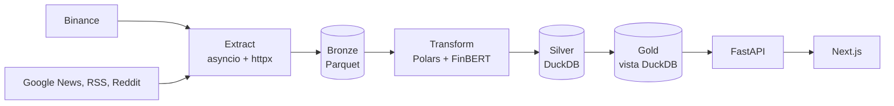

# Sentiment ELT

[](https://github.com/javier-hernaez/financial-sentiment-pipeline/actions/workflows/ci.yml)

Proyecto personal de ingeniería de datos. Un pipeline ELT descarga velas horarias de Binance y titulares de Google News, RSS y Reddit, puntúa cada titular con FinBERT y deja en DuckDB una tabla por hora con el precio y el sentimiento de las noticias de esa hora.

Incluye una web desde la que cualquiera puede lanzar el pipeline, ver cómo avanza etapa por etapa y explorar las tablas que genera.

## Cómo funciona



Los datos pasan por tres capas:

- Bronze guarda lo extraído tal cual, en Parquet particionado por fecha (`year=YYYY/month=MM/day=DD/`). No se modifica nunca, así que Silver se puede reconstruir sin volver a llamar a las APIs.
- Silver son dos tablas de DuckDB: velas y titulares puntuados. Polars limpia y normaliza a UTC; `ProsusAI/finbert` puntúa por lotes, ordenados por longitud para reducir el *padding*. Cada noticia se puntúa una sola vez aunque llegue por varios medios, y volver a ejecutar no duplica filas.
- Gold es una vista que agrega los titulares por hora, los une con las velas y calcula un índice de miedo y codicia a partir del sentimiento.

La extracción lanza todas las peticiones en paralelo y reintenta con *backoff* exponencial solo los errores transitorios (red, 429, 5xx). Si una fuente falla, las demás siguen.

## Decisiones que condicionan el diseño

DuckDB admite un solo proceso escritor por archivo, y de ahí salen varias cosas:

- La API corre en un único proceso, con una conexión compartida y un cursor por petición.
- El límite de peticiones vive en memoria, porque no hay más procesos con los que compartirlo.
- La CLI no puede escribir mientras la API está en marcha.

Con FinBERT en CPU una ejecución tarda desde unos segundos hasta varios minutos, más de lo que aguantan un proxy o un navegador. Por eso la API responde `202` y ejecuta en segundo plano; el progreso se guarda en la tabla `pipeline_runs`, la web lo consulta cada dos segundos y sobrevive a recargar la página. Si el servidor se reinicia a mitad, la ejecución queda marcada como fallida.

Las consultas a DuckDB y la lectura de Parquet son bloqueantes, así que van al *thread pool* de FastAPI en lugar de al *event loop*.

## Seguridad de la demo

La web es pública y permite lanzar ejecuciones, así que hay que acotar lo que puede hacer un visitante anónimo:

- `API_SECRET_KEY` solo la conoce el servidor de Next.js (`app/api/admin/[...slug]/route.ts`); nunca llega al navegador.
- Ese proxy solo deja pasar una lista cerrada de rutas (`lib/adminRoutes.ts`): las lecturas y las acciones que ofrece la propia web.
- Solo puede haber una ejecución a la vez, y hay un límite de peticiones por cliente.
- Dentro del contenedor la API escucha en `127.0.0.1` y solo confía en `X-Forwarded-For` si viene del proxy local.
- En producción la API no arranca con la clave por defecto; `start.sh` genera una aleatoria si no hay ninguna configurada.

Si Next.js se expone sin un proxy inverso delante, un cliente puede falsear `X-Forwarded-For` y saltarse el límite de peticiones. Detrás de uno, como en Hugging Face Spaces, no ocurre.

## Limitaciones

- Solo se puntúa el titular, no el cuerpo de la noticia.
- El índice de miedo y codicia es un cálculo propio sobre el sentimiento de los titulares, no el índice que publican otros sitios.
- No predice precios ni pretende hacerlo. El objetivo es el pipeline, no la señal.

## Ejecutarlo en local

Hace falta Python 3.12 y Node.

```bash
py -m venv venv
.\venv\Scripts\pip install -c requirements.lock -e ".[ml,dev]"
cd frontend
npm ci
```

```bash
copy .env.example .env
```

La API y el servidor de Next.js leen el mismo `.env`.

Para arrancar, doble clic en `start.bat` o `.\start.ps1` en Windows. Con Docker, `docker compose up`. La web queda en `http://localhost:3000` y la API, con su Swagger, en `http://localhost:8080/docs`.

El pipeline también se puede lanzar desde la línea de comandos, con la API parada:

```powershell
.\run_pipeline.ps1 -Symbol BTCUSDT -Hours 24
.\venv\Scripts\python -m src.main --symbol BTCUSDT --hours 24 --mock-nlp
```

`--mock-nlp` sustituye FinBERT por un motor heurístico, útil para probar sin descargar el modelo.

## Tests

La CI ejecuta esto mismo en cada push:

```bash
ruff check src tests benchmarks
ruff format --check src tests benchmarks
mypy
pytest -m "not network" --cov=src
pip-audit --requirement requirements.lock --no-deps --disable-pip
```

```bash
cd frontend
npm run lint
npm run typecheck
npm test
npm run build
npm audit --omit=dev
```

`requirements.lock` fija las versiones con las que pasan los tests. Tras cambiar `pyproject.toml` hay que regenerarlo:

```bash
uv pip compile pyproject.toml --extra ml --universal --python-version 3.12 -o requirements.lock
```

## Estructura

```
src/
  extractors/   Binance, Google News, RSS y Reddit
  storage/      Lago Bronze, esquema y almacén DuckDB
  nlp/          Limpieza de texto, FinBERT y motor heurístico
  pipeline/     Orquestador
  analytics/    Retornos, volatilidad y momento del sentimiento
  dashboard/    API: rutas, seguridad y ejecuciones en segundo plano
  main.py       CLI
frontend/       Web en Next.js
tests/
```
