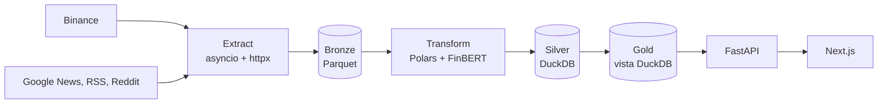

# Market Intelligence Engine: Financial Sentiment ELT

[](https://github.com/javier-hernaez/financial-sentiment-pipeline/actions/workflows/ci.yml)

Pipeline ELT con arquitectura **Medallion (Bronze / Silver / Gold)**. Extrae de forma asíncrona velas OHLCV de Binance y noticias de Google News, RSS y Reddit, clasifica cada titular con **FinBERT** y consolida el resultado por horas en **DuckDB**, junto a un índice de miedo y codicia derivado de ese sentimiento.

## Arquitectura



- **Extract:** peticiones en paralelo, reintentos con *backoff* exponencial solo para errores transitorios (red, 429, 5xx) y réplica de Binance para regiones bloqueadas. Una fuente que falla no detiene a las demás.
- **Bronze:** Parquet inmutable particionado por fecha (`year=YYYY/month=MM/day=DD/`), con escritura atómica.
- **Silver:** limpieza vectorizada con Polars e inferencia por lotes con `ProsusAI/finbert`, ordenada por longitud para reducir el *padding*. Cada historia se puntúa y se cuenta una sola vez.
- **Gold:** vista de DuckDB que agrega las menciones por hora antes de unirlas con las velas.

Más detalle en [docs/PRD.md](docs/PRD.md).

### Decisiones de diseño

| Decisión | Motivo |
| --- | --- |
| Una conexión DuckDB por proceso, un cursor por petición | DuckDB admite un solo proceso escritor por archivo. El esquema se crea una vez, al abrir la conexión. |
| Consultas en el *thread pool* de FastAPI | Las consultas y la lectura del lago son bloqueantes: en el *event loop* frenarían a todas las demás peticiones. |
| Ejecuciones en segundo plano (`202` + `pipeline_runs`) | Con FinBERT en CPU una ejecución dura minutos, más de lo que aguantan proxies y navegadores. El estado sobrevive a recargar la página, y un reinicio marca como fallidas las que quedaron a medias. |
| La API corre en un único proceso | Por la limitación de DuckDB. El límite de peticiones vive en memoria por el mismo motivo. |

### Modelo de seguridad

- La clave `API_SECRET_KEY` **nunca llega al navegador**: solo la conoce el servidor Next.js, en `app/api/admin/[...slug]/route.ts`.
- Como ese proxy actúa en nombre de visitantes anónimos, lo que deja pasar es público de hecho. Por eso usa una lista cerrada (`lib/adminRoutes.ts`): las vistas de solo lectura y las acciones que ofrece la propia demo.
- La API solo escucha en `127.0.0.1` dentro del contenedor y solo confía en `X-Forwarded-For` si viene de ese proxy local.
- En producción la API no arranca con la clave por defecto; `start.sh` genera una aleatoria si no se configura ninguna.
- Los errores inesperados se registran en el log y el cliente solo recibe un mensaje genérico.

**Límite conocido:** si Next.js se expone directamente sin un proxy inverso delante, un cliente puede falsear `X-Forwarded-For` y evadir el límite de peticiones. Aun así, nunca puede haber más de una ejecución a la vez. Detrás de un proxy inverso (como en Hugging Face Spaces) no ocurre.

## Inicio rápido

### 1. Instalar dependencias

`requirements.lock` fija las versiones exactas con las que se ejecutó la suite de tests.

```bash
py -m venv venv
.\venv\Scripts\pip install -c requirements.lock -e ".[ml,dev]"
cd frontend
npm ci
```

### 2. Configurar variables de entorno

```bash
copy .env.example .env
```

La API y el servidor Next.js local leen el mismo archivo.

### 3. Arrancar

- **Windows:** doble clic en `start.bat`, o `.\start.ps1` desde PowerShell.
- **Docker:** `docker compose up`.

| Servicio | URL |
| --- | --- |
| Web | `http://localhost:3000` |
| API y Swagger UI | `http://localhost:8080/docs` |

### 4. Ejecutar el pipeline

Se puede lanzar desde la web o desde la línea de comandos. DuckDB admite un solo proceso escritor, así que la CLI necesita que la API esté parada.

```powershell
.\run_pipeline.ps1 -Symbol BTCUSDT -Hours 24
.\venv\Scripts\python -m src.main --symbol BTCUSDT --hours 24 --mock-nlp
```

## Calidad

Lo mismo que comprueba la CI:

```bash
ruff check src tests benchmarks
ruff format --check src tests benchmarks
mypy
pytest -m "not network" --cov=src
pip-audit --requirement requirements.lock --no-deps --disable-pip
```

```bash
cd frontend
npm run lint
npm run typecheck
npm test
npm run build
npm audit --omit=dev
```

### Actualizar las versiones fijadas

Tras cambiar `pyproject.toml`, vuelve a generar el lockfile y ejecuta los tests con el resultado:

```bash
uv pip compile pyproject.toml --extra ml --universal --python-version 3.12 -o requirements.lock
```

## Estructura del repositorio

```
sentiment-analysis/
├── docs/PRD.md                  # Requisitos y arquitectura
├── src/
│   ├── configs/                 # Configuración y logging
│   ├── extractors/              # Binance, Google News, RSS y Reddit
│   ├── storage/                 # Lago Bronze, esquema y almacén DuckDB
│   ├── nlp/                     # Limpieza, FinBERT y motor heurístico de respaldo
│   ├── pipeline/                # Orquestador E -> L -> T
│   ├── analytics/               # Señales cuantitativas
│   ├── dashboard/               # API: rutas, seguridad y trabajos en segundo plano
│   └── main.py                  # CLI
├── frontend/                    # Web Next.js
├── tests/                       # Tests de la API, el pipeline y el almacén
├── requirements.lock            # Versiones exactas probadas
└── Dockerfile, start.sh         # Imagen y arranque en producción
```
